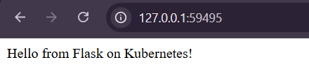

# Exercise 2: Deploy a Flask App on Minikube

Build a Flask app into a Docker image, load it into Minikube, deploy it with a Deployment, and expose it with a NodePort Service.

## Files

| File | Purpose |
|---|---|
| `app.py` | Flask app listening on port 15000 |
| `Dockerfile` | Packages the app into an image |
| `flask-deployment.yaml` | Deployment and Service |

## Steps (Windows PowerShell)

1. Start the cluster: `minikube start --driver=docker`
2. Build the image: `docker build -t flask-app .`
3. Load it into Minikube: `minikube image load flask-app:latest`
4. Deploy: `kubectl apply -f flask-deployment.yaml`
5. Verify: `kubectl get deployments` and `kubectl get pods -l app=flask-app`
6. Check logs: `kubectl logs -l app=flask-app`
7. Get the URL: `minikube service flask-app-service --url`
8. Test it: `curl.exe <URL>`, which returns `Hello from Flask on Kubernetes!`

## Key idea: port vs targetPort

- `port`: the port the Service exposes
- `targetPort`: the port the container listens on

Request -> Service (15000) -> Container (15000)

## Why `imagePullPolicy: Never`?

The image exists only inside Minikube, so Kubernetes must not try to pull it from Docker Hub.
