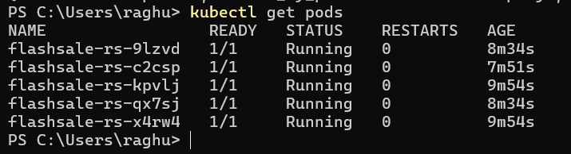
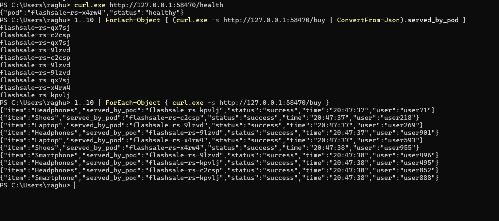

# Exercise 3: Scaling a Flask App with a ReplicaSet

Flash-sale scenario: run several identical pods of the same app, scale them up and down, and see Kubernetes replace a deleted pod automatically.

## Files

| File | Purpose |
|---|---|
| `app.py` | Flask app with `/`, `/buy` and `/health`, and shows which pod served the request |
| `Dockerfile` | Packages the app with gunicorn |
| `flashsale-replicaset.yaml` | ReplicaSet (3 replicas) and NodePort Service |

## Steps (Windows PowerShell)

1. Build: `docker build -t flashsale:1.0 .`
2. Load into Minikube: `minikube image load flashsale:1.0`
3. Deploy: `kubectl apply -f flashsale-replicaset.yaml`
4. Verify: `kubectl get pods` and `kubectl get rs`
5. Scale: `kubectl scale rs flashsale-rs --replicas=5`
6. Self-heal: delete one pod with `kubectl delete pod <name>` and watch a new one appear
7. Node placement: `kubectl get pods -o wide`
8. Access: `minikube service flashsale-svc --url`, then call `/buy` several times with `curl.exe`

## Key observations

- **Pod distribution:** each pod is an identical clone of the app.
- **Resiliency:** if a pod dies, the ReplicaSet creates a replacement.
- **Efficiency:** add pods when traffic spikes and remove them afterwards.

## Q&A

1. Initial replicas: 3
2. Pods after apply: 3
3. After scaling to 5: Kubernetes creates 2 more pods
4. After deleting a pod: a new pod is created to keep 5 running
5. How it keeps the count: a controller compares desired state with actual state and creates or deletes pods to match
6. Nodes: 1
7. All 5 pods run on the single `minikube` node
