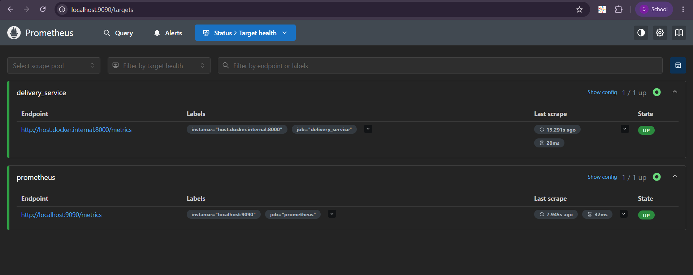
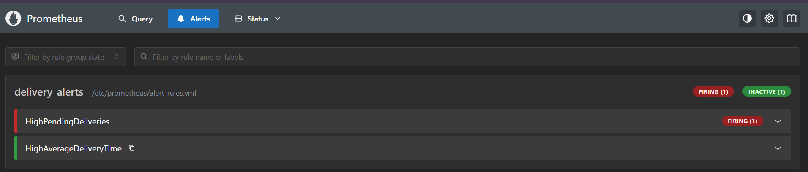
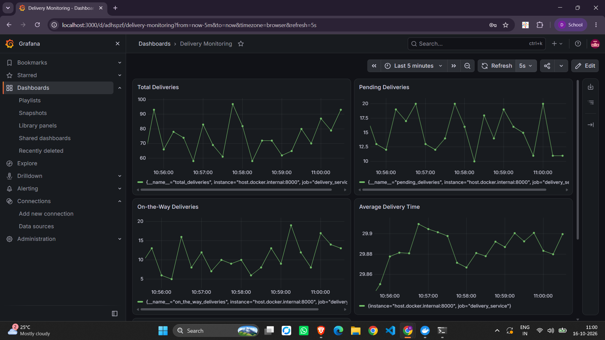

# Exercise 6: Real-Time Delivery Monitoring and Alerting

A Python app simulates delivery metrics, Prometheus scrapes them, Grafana shows a dashboard, and alert rules fire when pending deliveries or average delivery time get too high.

## Files

| File | Purpose |
|---|---|
| `delivery_metrics.py` | Exposes `total_deliveries`, `pending_deliveries`, `on_the_way_deliveries` and `average_delivery_time` on port 8000 |
| `prometheus.yml` | Scrape config (target `host.docker.internal:8000`) |
| `alert_rules.yml` | `HighPendingDeliveries` and `HighAverageDeliveryTime` alerts |
| `Dockerfile` | Packages the metrics app |

## Steps (Windows PowerShell)

1. Run the app: `python delivery_metrics.py`, then check `http://localhost:8000/metrics`
2. Create a network: `docker network create monitoring-net`
3. Run Prometheus on that network with `prometheus.yml` and `alert_rules.yml` mounted, port 9090
4. Run Grafana on the same network, port 3000
5. Add the Prometheus data source with URL `http://prometheus:9090`
6. Build a dashboard with four panels (total, pending, on-the-way, average delivery time)
7. Raise `pending` to `random.randint(50, 100)` and watch `HighPendingDeliveries` fire







## Notes

- Metric types: Counter counts up, Gauge goes up and down, Histogram uses buckets, Summary tracks count and sum (used for the average).
- On Docker Desktop, containers reach the host through `host.docker.internal`. On Linux use the docker0 IP (for example `172.17.0.1`).
- `/metrics` is created automatically by `start_http_server`.

## Cleanup

```
docker rm -f prometheus grafana jenkins delivery_metrics
docker network rm monitoring-net
```
