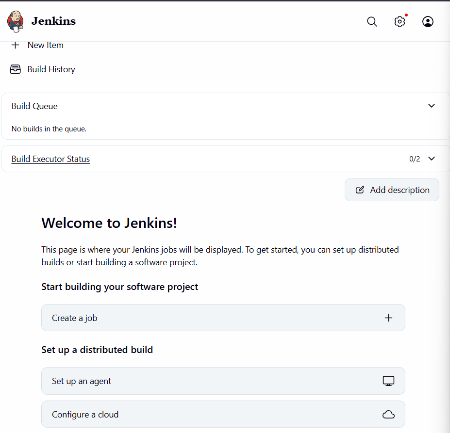
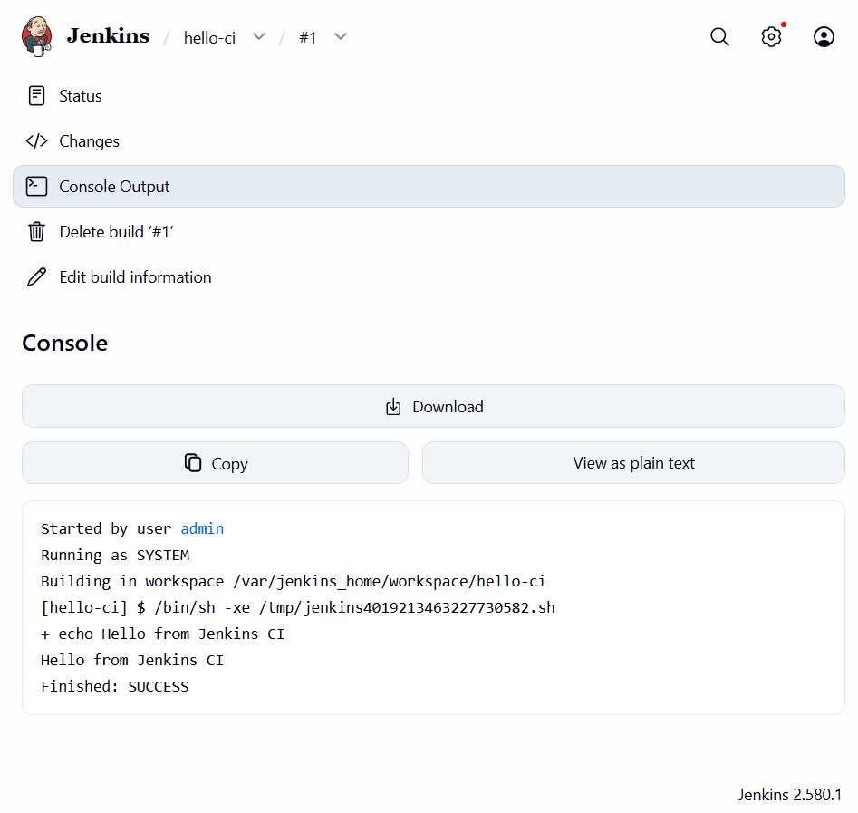

# Exercise 7: Introduction to CI and Jenkins Installation

## What is Continuous Integration (CI)?

Developers merge code into a shared repository often. Each merge triggers an automated build and test run, so errors show up early.

**Key features:** frequent integration, automated builds, automated tests, immediate feedback.

**Benefits:** early bug detection, better collaboration, faster delivery, higher code quality.

## How CI works

1. A developer pushes code to Git.
2. The CI server detects the change and starts a build.
3. The code is built and dependencies are resolved.
4. Automated tests run.
5. Results go back to the developer.

## CI tools

| Tool | Notes |
|---|---|
| Jenkins | Open-source, plugin-rich, self-hosted |
| GitLab CI/CD | Built into GitLab, YAML pipelines |
| GitHub Actions | Built into GitHub, large marketplace of actions |
| CircleCI | Cloud-based, container-first |
| Travis CI | Popular with open-source projects |
| Bamboo | Atlassian, integrates with Jira and Bitbucket |
| TeamCity | JetBrains, strong reporting |
| Azure Pipelines | Azure DevOps, multi-platform |
| Spinnaker | Continuous delivery for multi-cloud and Kubernetes |
| Buildkite | Hybrid: cloud control plane with self-hosted agents |
| Drone | Container-native pipelines |

## What is Jenkins?

An open-source automation server that builds, tests and deploys software.

**Key concepts:** Job/Project, Build, Pipeline, Plugins, Nodes (controller and agents).

## Install Jenkins with Docker (Windows PowerShell)

1. Run: `docker run -d --name jenkins -p 8081:8080 -p 50000:50000 -v jenkins_home:/var/jenkins_home jenkins/jenkins:lts`
2. Get the password: `docker exec jenkins cat /var/jenkins_home/secrets/initialAdminPassword`
3. Open `http://127.0.0.1:8081` and paste the password
4. Install suggested plugins and continue as admin

Port 8081 on the host maps to Jenkins' port 8080 in the container, because port 8080 was already in use on this machine. Port 50000 is for build agents.



## Test build

Created a Freestyle project `hello-ci` with an **Execute shell** step (`echo "Hello from Jenkins CI"`) and ran **Build Now**. The build finished with `SUCCESS`.



## Cleanup

```
docker stop jenkins
docker rm jenkins
```

Add `docker volume rm jenkins_home` to delete Jenkins data as well.
