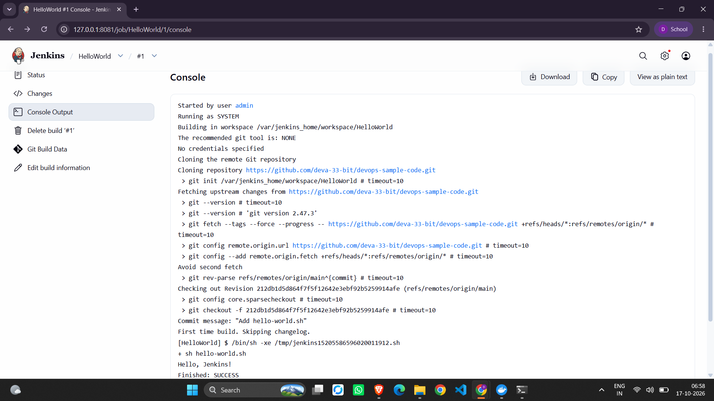
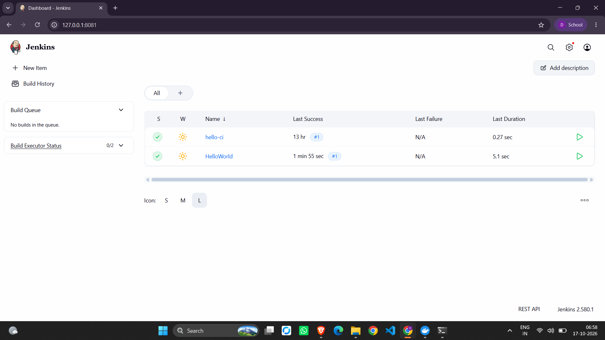

# Exercise 8: "Hello World" Jenkins Job

A Freestyle Jenkins job that clones a script from GitHub and runs it.

Script repository: https://github.com/deva-33-bit/devops-sample-code

## Steps (Windows PowerShell)

1. Create the public repo `devops-sample-code` on GitHub (no README).
2. Create `hello-world.sh` locally (with LF line endings) containing:
```
   #!/bin/bash
   echo 'Hello, Jenkins!'
```
3. Push it: `git init`, `git branch -M main`, `git add .`, `git commit`, `git remote add origin ...`, `git push -u origin main`
4. Start Jenkins: `docker start jenkins` and open `http://127.0.0.1:8081`
5. Create a Freestyle project `HelloWorld`:
   - Source Code Management: Git, repo URL above, branch `*/main`
   - Build step: Execute shell, `sh hello-world.sh`
6. Click **Build Now**, then open **Console Output**





## Notes

- The Jenkins Git plugin defaults to branch `*/master`, so it must be changed to `*/main`.
- `chmod +x` is not needed on Windows, and `sh hello-world.sh` runs the script without it.
- Each build clones the repo into `/var/jenkins_home/workspace/HelloWorld`.

## Cleanup

```
docker stop jenkins
```
