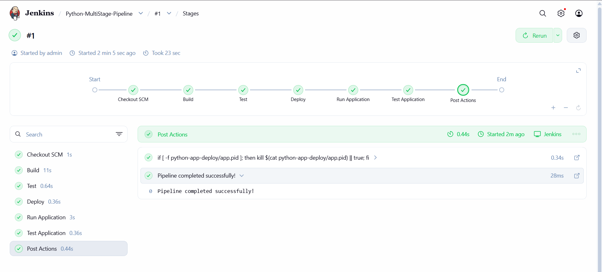
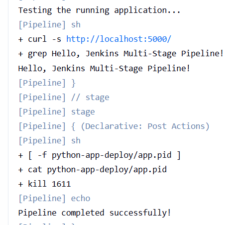

# Exercise 9: Jenkins Multi-Stage Pipeline

A Jenkins Pipeline that builds, tests, deploys and runs a Flask app, then checks it with `curl`.

Code repository: https://github.com/deva-33-bit/devops-sample-code

## Files

| File | Purpose |
|---|---|
| `app.py` | Flask app returning `Hello, Jenkins Multi-Stage Pipeline!` |
| `requirements.txt` | Dependencies (`flask==3.0.3`) |
| `test_app.py` | Unit test |
| `Jenkinsfile` | Pipeline: Build, Test, Deploy, Run Application, Test Application |

## Steps (Windows PowerShell)

1. Push the files to `devops-sample-code` (with a `.gitattributes` forcing LF line endings).
2. Start Jenkins: `docker start jenkins`, then install Python as root:
   `docker exec -u root jenkins bash -c "apt-get update && apt-get install -y python3 python3-venv python3-pip curl"`
3. Create a **Pipeline** job `Python-MultiStage-Pipeline`:
   - Definition: Pipeline script from SCM, Git, the repo URL above, branch `*/main`, script path `Jenkinsfile`
4. Click **Build Now** and watch the stages.





## What each stage does

| Stage | Action |
|---|---|
| Build | Creates a virtual environment and installs dependencies |
| Test | Runs the unit tests |
| Deploy | Copies `app.py` to `python-app-deploy/` |
| Run Application | Starts the app in the background |
| Test Application | Calls the app with `curl` and checks the response |
| Post Actions | Stops the app and reports the result |

## Notes

- The stock Jenkins image has no Python, so it is installed as root inside the container.
- The app is started with `JENKINS_NODE_COOKIE=dontKillMe` so Jenkins doesn't kill it between stages, and a `post` step stops it afterwards.
- Possible enhancements: a flake8 code-quality stage, deploying into a Docker container, and Slack or email notifications.

## Cleanup

```
docker stop jenkins
```
