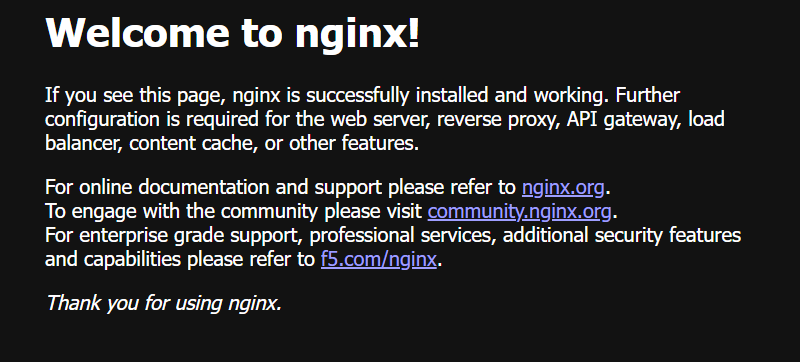

# Kubernetes Hands-On Exercises

Practice exercises for learning Kubernetes with Minikube.

| Exercise | Topic |
|---|---|
| [Exercise-1](Exercise-1/README.md) | Hello Pod: run nginx in a Pod and expose it with a Service |
| [Exercise-2](Exercise-2/README.md) | Flask app: Dockerfile, Deployment and NodePort Service |
| [Exercise-3](Exercise-3/README.md) | Scaling a Flask app with a ReplicaSet |
| [Exercise-4](Exercise-4/README.md) | Docker networking: Flask, MySQL and Redis on a bridge network |
| [Exercise-5](Exercise-5/README.md) | Docker security: AppArmor profile with the Python Docker SDK |
| [Exercise-6](Exercise-6/README.md) | Monitoring: Python metrics, Prometheus, Grafana and Jenkins |

